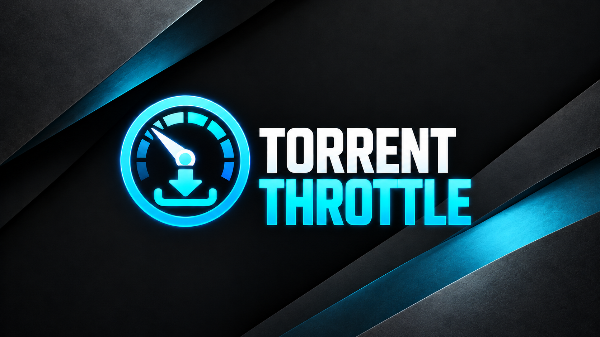
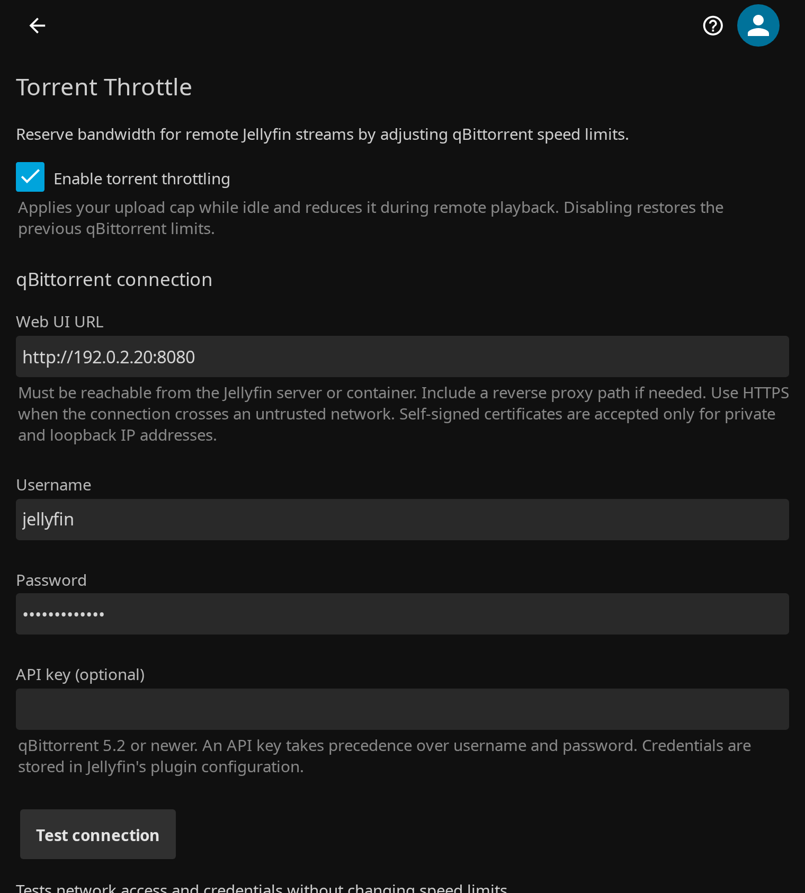

<p align="center">
  
</p>

# Jellyfin Torrent Throttle

<p align="center">
  
  <a href="https://github.com/voc0der/jellyfin-plugin-torrent-throttle/releases/latest">
    
  </a>
  <a href="https://github.com/voc0der/jellyfin-plugin-torrent-throttle/blob/main/manifest.json">
    
  </a>
  <a href="https://github.com/voc0der/jellyfin-plugin-torrent-throttle/tree/main/tests">
    
  </a>
  <a href="https://github.com/voc0der/jellyfin-plugin-torrent-throttle/actions/workflows/codeql.yml">
    
  </a>
  <a href="https://github.com/voc0der/jellyfin-plugin-torrent-throttle/issues">
    
  </a>
  <a href="LICENSE">
    
  </a>
</p>

A Jellyfin plugin that keeps remote streams smooth by lowering qBittorrent's speed limits while people are watching away from home. It subtracts the combined bitrate of active remote streams from your torrent upload cap, and optionally your download cap, then returns to your configured caps when playback stops and restores the previous qBittorrent limits when disabled.

<p align="center">
  
</p>
<p align="center">
  <em>Configuration page inside the Jellyfin dashboard</em>
</p>

## Features

- Reacts to playback start, pause, resume and stop; no polling
- Reserves bandwidth only for remote streams; LAN playback is ignored using Jellyfin's network settings
- Concurrent streams share one budget, with configurable headroom
- Waits 5 seconds (configurable) before throttling, so brief starts and skips don't touch your limits
- Optional download throttling using the same reservation
- qBittorrent username/password or API key (qBittorrent 5.2+)
- Restores your original limits when disabled or when Jellyfin shuts down, and recovers them after a crash
- Test connection button and live status in the settings page

## Installation

### From Plugin Repository

1. In Jellyfin, go to **Dashboard > Plugins > Repositories**
2. Add: `https://raw.githubusercontent.com/voc0der/jellyfin-plugin-torrent-throttle/main/manifest.json`
3. Install **Torrent Throttle** from the catalog

> [!NOTE]
> Full repository of this author's plugins: [voc0der/jellyfin-plugins](https://github.com/voc0der/jellyfin-plugins).

### Manual

1. Download the latest release ZIP
2. Extract to your Jellyfin plugins directory
3. Restart Jellyfin

#### Building from source

```bash
dotnet build --configuration Release
```

## Configuration

Go to **Dashboard > Plugins > Torrent Throttle**:

- **Web UI URL** — qBittorrent's Web UI as reached from the Jellyfin server or container, e.g. `http://192.168.1.20:8080`. HTTPS certificates are verified, except on private and loopback addresses (e.g. `https://172.30.12.103`), where self-signed certificates are accepted
- **Username / Password** or **API key** — the API key takes precedence when both are set
- **Maximum torrent upload** — your normal upload cap in KiB/s, applied while nobody is streaming remotely (default: 1024)
- **Also throttle downloads** / **Maximum torrent download** — subtract the same reservation from the download cap (default: off)
- **Playback settling time** — seconds to wait before a new or resumed stream counts (default: 5)
- **Extra bandwidth reservation** — headroom added to stream bitrates (default: 10%)
- **Fallback stream bitrate** — used when a stream's bitrate is unknown (default: 20 Mbps)

While enabled, the plugin owns qBittorrent's normal and alternative speed limits. Disable it before changing those limits in qBittorrent, and before uninstalling, so your originals are restored.
